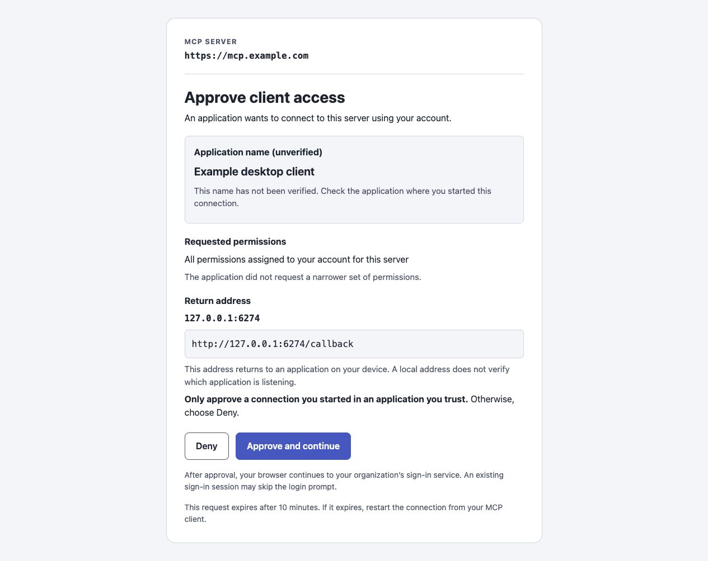

# Approval page maintenance

The library renders the MCP client's approval page before XSUAA sign-in. This page
belongs to the MCP server, not to the identity provider. It is distinct from accepting
an identity provider's terms or granting new BTP role collections.

Example rendered with synthetic data; no real account or credentials.
The exact appearance in a consuming application depends on its installed library version.

## Presentation and trust

`src/oauth-consent-page.ts` renders the approval and invalid-request documents.
`src/oauth-consent.ts` owns validation, signing, cookies and response headers.
Keep those responsibilities separate. The renderer must not decide authorization.

- Server identity comes from the configured authorization URL, never the incoming
  `Host` header or client registration metadata.
- Registered client names are marked unverified; DCR clients supply their own names.
  Names longer than 100 Unicode code points are shortened with an explicit note.
  No client logos, branding links, fetched images or trusted-publisher badges are shown.
- The complete browser-normalized return address is visible and wraps instead of
  being truncated. Display normalization never changes the signed redirect value.
  A separate short line shows the parsed host (or the scheme for application URIs),
  keeping the destination easy to identify without another explanatory paragraph.
  A loopback address returns to a local app; an application URI scheme opens its
  registered handler. Neither address type verifies the application's identity.
  These explanations stay in documentation to keep the decision page concise.
- Scope names are displayed literally. Their meaning belongs to the consuming
  server. Do not equate a name such as `read` with read-only access in arbitrary apps.
  An omitted scope request must not look like a request for no permissions.
- Approval covers one authorization request. There are no remembered approvals.
  Refresh-token exchanges and MCP calls do not display this page.
- Deny comes first in DOM and keyboard order. Neither action receives autofocus.
  The error document has no retry form that could resubmit expired request data.

The [MCP authorization specification](https://modelcontextprotocol.io/docs/draft/tutorials/security/security_best_practices#mitigation)
requires client consent before a proxy forwards dynamically registered clients to an
upstream authorization server. Clear presentation supports this boundary; styling
must never replace request validation or introduce automatic approval.

## Compatibility constraints

Keep native POST submission and the complete hidden field set unchanged. Preserve
same-origin validation, signed request fields, separate approval/callback cookies,
ten-minute expiry and all existing response headers.

The document's `Referrer-Policy: origin` lets browsers send the required Origin on
the form POST without exposing OAuth query parameters. Do not change it to
`no-referrer` on the approval document. The subsequent redirect already uses
`no-referrer`. Do not add a `form-action 'self'` CSP restriction: it breaks subsequent
XSUAA/IdP redirects in Chromium/WebKit. Do not add COOP: popup-based clients depend
on the opener. Keep CSP, frame denial and no-store protections intact.

## Verification

Run `npm test`, `npm run typecheck`, `npm run lint`, `npm run build` and
`npm run check:exports`. The library suites cover actual form field round-trips,
headers, approval/denial, browser binding, scoped/manual clients and refresh behavior.
The renderer suite covers identity separation, scope text, complete callback addresses,
long values, escaping, form order and the invalid-request page.

For a local synthetic preview using the built renderer, check:

1. Desktop and 320 CSS pixel width: no horizontal scrolling or lost text; long
   displayed application names, scope identifiers and callback addresses remain readable.
2. Keyboard: Tab reaches Deny, then Approve; both have a visible focus outline.
   No action happens merely from loading the page or moving focus.
3. Light and dark themes: text contrast is at least 4.5:1. Buttons are at least
   44 CSS pixels tall at the default text size. Check forced colors independently.
4. Text enlargement and narrow windows: buttons wrap without overlapping content.
   A 320 CSS pixel viewport checks reflow; it is not a substitute for all zoom checks.
5. A screen reader: one main landmark, one h1, meaningful section headings, complete
   callback text and understandable button names. Automated structure checks alone
   do not establish screen-reader usability or WCAG conformance.
6. Empty scopes, explicit custom scopes, loopback/HTTPS/application callbacks and
   expired requests. Never use real tokens or credentials in screenshots.

These checks follow WCAG guidance on
[reflow](https://www.w3.org/WAI/WCAG22/Understanding/reflow.html),
[contrast](https://www.w3.org/WAI/WCAG22/Understanding/contrast-minimum.html),
[visible focus](https://www.w3.org/WAI/WCAG22/Understanding/focus-visible.html) and
[target size](https://www.w3.org/WAI/WCAG22/Understanding/target-size-minimum.html).
Full assistive-technology and cross-browser certification requires additional testing.
